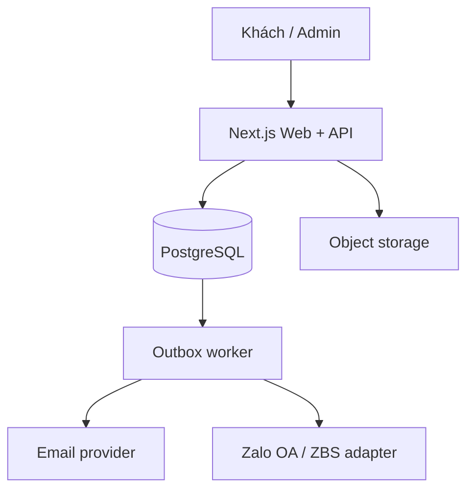

# KẾ HOẠCH TRIỂN KHAI WEBSITE NTECH-AI.VN

**Phiên bản:** 1.0 — 26/09/2026  
**Mục tiêu tài liệu:** đặc tả sản phẩm và kế hoạch thực thi đủ rõ để giao từng giai đoạn cho Codex coding.  
**Phạm vi:** website công ty NTECH AI, cửa hàng machine vision/embedded/phần mềm, bài viết kỹ thuật và trang quản trị. Tên miền dự kiến `ntech-ai.vn`; quyền sở hữu tên miền, DNS và nội dung doanh nghiệp cần được xác nhận khi triển khai.

## 1. MỤC TIÊU VÀ NGUYÊN TẮC

Website phải làm được bốn việc: (1) trình bày năng lực và tạo lead B2B; (2) bán sản phẩm có giá công khai và nhận yêu cầu báo giá cho thiết bị/giải pháp cần tư vấn; (3) xuất bản kiến thức chuyên môn; (4) giúp nhân sự theo dõi đơn, nội dung, traffic và doanh thu.

Khách chính: kỹ sư machine vision, tích hợp hệ thống, nhà máy, đội R&D robotics/embedded và người mua phần mềm kỹ thuật. Thông điệp nội dung nên ưu tiên giải pháp có ứng dụng thực, thông số kiểm chứng được, tài liệu kỹ thuật và cách liên hệ rõ ràng. Không tự tạo case study, chứng nhận, logo đối tác hoặc giá khi chưa có dữ liệu thực.

**Quyết định kiến trúc cho bản đầu:** một ứng dụng web dạng modular monolith, một PostgreSQL, một nơi lưu file, một worker thông báo. Việt ngữ là nội dung gốc; cấu trúc dữ liệu cho phép thêm tiếng Anh về sau. Đồng tiền VND, múi giờ hiển thị Asia/Ho_Chi_Minh; thời gian trong DB là UTC.

## 2. PHẠM VI THEO GIAI ĐOẠN

| Hạng mục | MVP có thể đưa vào vận hành | Giai đoạn 2 |
|---|---|---|
| Thương hiệu | Trang chủ, giới thiệu, giải pháp, liên hệ, CTA báo giá | Case study, tài nguyên tải về, landing page chiến dịch |
| Catalog | Danh mục, bộ lọc, tìm kiếm, chi tiết sản phẩm, sản phẩm liên quan | So sánh thông số, cấu hình biến thể phức tạp |
| Giao dịch | Giỏ cho SKU bán trực tiếp, đặt hàng không cần tài khoản, chuyển khoản thủ công; yêu cầu báo giá riêng | Cổng thanh toán, đồng bộ vận chuyển/kho, hóa đơn tự động |
| Phần mềm/tool | Catalog và đặt mua license do nhân sự xử lý | Cấp license/download tự động sau xác nhận thanh toán |
| Nội dung | Blog: draft, preview, publish, tác giả, tag, SEO | Lịch xuất bản, phiên bản đa ngôn ngữ |
| Admin | Sản phẩm, bài viết, đơn, báo giá, user/role, dashboard cơ bản, audit | CRM nâng cao, báo cáo lợi nhuận, đa kho |
| Kết nối | Email giao dịch; Zalo OA chat/link và adapter thông báo khi đủ điều kiện | Zalo thông báo tự động theo mẫu/đối tượng được phê duyệt |

MVP **không** giả định có merchant account, OA được xác thực, API gửi tin đã được duyệt, SMTP/domain email, hay thông tin pháp lý doanh nghiệp. Những phụ thuộc này có cờ cấu hình; thiếu chúng không được làm mất đơn hàng.

### Loại sản phẩm và cách mua

| Loại | Ví dụ | CTA | Dữ liệu bắt buộc | Kết quả |
|---|---|---|---|---|
| `DIRECT` | Tool có giá cố định, kit/phụ kiện có tồn kho xác định | Thêm vào giỏ | SKU, giá VND, VAT/thuế hiển thị, tình trạng, phương thức giao | Order ở trạng thái chờ xử lý/thanh toán |
| `QUOTE` | Camera công nghiệp, frame grabber, giải pháp vision tích hợp | Yêu cầu báo giá | Tên, liên hệ, số lượng, mô tả ứng dụng | Quote request/lead; chưa tính doanh thu |
| `CONTACT` | Dịch vụ/giải pháp chưa thể định giá | Tư vấn | Nội dung nhu cầu, liên hệ | Lead; không vào giỏ |

Nếu người dùng muốn cả SKU `DIRECT` và `QUOTE`, website hiển thị hai luồng rõ ràng: đặt mua phần có giá và gửi yêu cầu báo giá phần còn lại. Không tạo khoản tiền phải trả từ một sản phẩm “liên hệ giá”.

## 3. SITEMAP VÀ TRẢI NGHIỆM

**Public:** `/`, `/gioi-thieu`, `/giai-phap`, `/giai-phap/[slug]`, `/san-pham`, `/san-pham/[slug]`, `/danh-muc/[slug]`, `/gio-hang`, `/thanh-toan`, `/don-hang/[token]`, `/yeu-cau-bao-gia`, `/bai-viet`, `/bai-viet/[slug]`, `/lien-he`, `/tim-kiem`, `/chinh-sach/{bao-mat,thanh-toan,van-chuyen,bao-hanh,doi-tra,dieu-khoan}`.

**Admin:** `/admin`, `/admin/products`, `/admin/categories`, `/admin/posts`, `/admin/media`, `/admin/orders`, `/admin/quotes`, `/admin/leads`, `/admin/users`, `/admin/roles`, `/admin/analytics`, `/admin/settings`, `/admin/audit`.

### Trang chủ

Hero có định vị công ty và hai CTA “Xem sản phẩm”, “Tư vấn giải pháp”; tiếp theo là nhóm Machine Vision, Embedded/Edge AI, Software & Tools; khối giải pháp theo ứng dụng (kiểm tra chất lượng, OCR/OCV, camera công nghiệp, xử lý trên edge); sản phẩm nổi bật; bài viết kỹ thuật; năng lực/quy trình làm việc; form liên hệ. Hình ảnh và copy phải là dữ liệu thật hoặc placeholder được đánh dấu trong môi trường phát triển.

### Chi tiết sản phẩm

Tên, hãng/model/SKU, ảnh, tình trạng, giá hoặc “Yêu cầu báo giá”, thông số theo nhóm, file datasheet, hỗ trợ/tương thích, bảo hành, giao hàng, sản phẩm liên quan, CTA liên hệ. Không hiển thị mức tồn kho/khẳng định phân phối chính hãng nếu chưa có nguồn dữ liệu. Sản phẩm phần mềm thêm hệ điều hành hỗ trợ, loại license, thời hạn, phương thức bàn giao và phiên bản.

### Thiết kế giao diện

Hiện đại, kỹ thuật nhưng dễ đọc: nền sáng chủ đạo, màu nhận diện được chốt từ logo thực, typography rõ trên mobile, ảnh sản phẩm thật, card thống nhất, filter dễ dùng, navigation tối đa 2 cấp. Tạo design tokens cho màu, spacing, radius, type; xây component cơ bản cho Button, Form, ProductCard, DataTable, StatusBadge, Modal, EmptyState. Thiết kế desktop 1440 px, tablet 768 px, mobile 390 px; kiểm tra bàn phím, tương phản, alt text và trạng thái lỗi/loading.

## 4. LUỒNG NGHIỆP VỤ

### 4.1 Giỏ hàng và đặt hàng

1. Giỏ lưu tạm trên trình duyệt; khi checkout, server đọc SKU/giá/tình trạng mới từ DB và tính lại tổng tiền. Không tin giá hoặc discount gửi từ client.
2. Checkout guest yêu cầu tên, email, điện thoại, địa chỉ nếu hàng vật lý, ghi chú; yêu cầu đồng ý điều khoản và chính sách dữ liệu. Địa chỉ giao hàng có thể không cần cho license điện tử.
3. Trong transaction: tạo `Order` + `OrderItem` với snapshot tên/SKU/đơn giá/thuế/phí giao; sinh mã đơn duy nhất và token tra cứu ngẫu nhiên; ghi `OutboxEvent` để gửi thông báo. Idempotency key ngăn double submit.
4. Trang xác nhận trả mã đơn và trạng thái. Gửi email cho khách và email cho đội bán hàng qua worker. Nếu kênh lỗi, retry có giới hạn và hiển thị cảnh báo trong admin; đơn vẫn tồn tại.
5. MVP chọn `BANK_TRANSFER` hoặc `MANUAL_CONFIRMATION`. Hiển thị hướng dẫn thanh toán chỉ khi thông tin ngân hàng đã được cấu hình; nhân sự xác nhận đã nhận tiền trong admin với audit log. Không tự đánh dấu “đã thanh toán” dựa trên màn hình chuyển khoản hoặc redirect.
6. Nếu thêm payment gateway: tạo payment attempt riêng, xác minh chữ ký/webhook server to server, idempotent theo transaction ID, đối soát số tiền/mã đơn; redirect phía khách chỉ là UI. Refund là giao dịch riêng, không sửa lịch sử payment cũ.

**Trạng thái đơn:** `NEW → CONFIRMED → PROCESSING → FULFILLED`; có nhánh `CANCELLED`. Payment state tách riêng: `UNPAID → PENDING → PAID`, `FAILED`, `REFUNDED/PARTIALLY_REFUNDED`. Delivery state tách riêng. Hệ thống lưu lịch sử chuyển trạng thái và actor.

### 4.2 Báo giá và lead

Form báo giá gồm sản phẩm/số lượng, tên công ty, người liên hệ, email/điện thoại, yêu cầu kỹ thuật, deadline tùy chọn; chống spam và giới hạn tần suất. Tạo mã quote request, xác nhận email, thông báo nhân sự. Pipeline `NEW → QUALIFYING → QUOTED → WON/LOST`, có ghi chú nội bộ và người phụ trách. Khi thắng deal, tạo đơn bán hàng qua admin với giá chốt; không cộng quote vào doanh thu trước khi thanh toán.

### 4.3 Zalo và email

“Gửi đơn qua email và Zalo” được triển khai theo nghĩa **đơn hàng được lưu trước, rồi thông báo qua kênh hợp lệ**. Email là kênh giao dịch mặc định; Zalo có ba mức: (a) nút chat OA và link chia sẻ mã đơn; (b) widget xin quyền tương tác/đồng bộ định danh khi phù hợp; (c) API thông báo khách qua OA/ZBS Template Message sau khi OA, ứng dụng, quyền gửi, template, phí và webhook được cấu hình/duyệt. Tin cho nhân viên cũng phải là luồng hợp lệ của OA hoặc một kênh nội bộ đã được cấp quyền; không dùng automation giả lập tài khoản Zalo cá nhân.

Các adapter `EmailNotifier` và `ZaloNotifier` nhận cùng một domain event (`order.created`, `quote.created`, `order.status_changed`); lưu mỗi lần gửi, kết quả, số lần thử, lỗi rút gọn và thời điểm retry. Không để thông tin cá nhân đầy đủ trong log. Không hứa “gửi thẳng Zalo” cho mọi số điện thoại khi chưa xác nhận khả năng gửi thực tế trong tài khoản NTECH AI.

### 4.4 Phần mềm số

MVP nhân viên bàn giao license/link sau khi xác nhận thanh toán. Giai đoạn 2: `LicenseEntitlement` gắn vào order item đã `PAID`, phát hành key hoặc quyền tải có thời hạn, giới hạn số lần tải, ghi audit, thu hồi/refund theo policy. File nhị phân ở private storage; URL ký ngắn hạn. Không đặt key/license trong HTML hoặc email admin public.

## 5. DASHBOARD, ROLE VÀ SỐ LIỆU

| Quyền | Owner | Admin | Sales | Editor | Analyst |
|---|:---:|:---:|:---:|:---:|:---:|
| Cấu hình hệ thống, phân quyền | ✓ | giới hạn | — | — | — |
| Quản lý user | ✓ | ✓ | — | — | — |
| Sản phẩm, danh mục | ✓ | ✓ | xem | — | xem |
| Đơn, báo giá, lead | ✓ | ✓ | ✓ | — | xem tổng hợp |
| Bài viết, media | ✓ | ✓ | — | ✓ | xem |
| Dashboard doanh thu/traffic | ✓ | ✓ | số liệu bán hàng | nội dung | ✓ |
| Export dữ liệu khách | ✓ | theo quyền riêng | theo quyền riêng | — | dữ liệu tổng hợp |

Kiểm tra quyền ở server trên từng hành động và truy vấn DB; ẩn nút trên UI chỉ là tiện ích. Tài khoản admin bằng email/password hash an toàn, MFA cho Owner/Admin, session cookie `HttpOnly/Secure/SameSite`, reset password qua token ngắn hạn. Seed Owner ban đầu qua lệnh CLI và secret nhập lúc deploy, không hardcode tài khoản mẫu.

Dashboard MVP: tổng đơn mới/chờ xử lý, doanh thu **đã thanh toán** theo ngày/tuần/tháng, số refund, AOV từ đơn đã thanh toán, số quote/lead và tỷ lệ chuyển đổi có định nghĩa mẫu số, top sản phẩm, bài viết có lượt xem, phiên truy cập và nguồn traffic. Filter theo khoảng thời gian và timezone; cho biết thời điểm cập nhật. Tách `gross_paid`, `refunds`, `net_revenue = gross_paid - refunds`, không cộng đơn chưa thanh toán hoặc báo giá. Nếu cần doanh thu kế toán/VAT/hóa đơn, đặc tả đối soát và định nghĩa ghi nhận với kế toán trước khi thêm.

Traffic dùng sự kiện trang đã đồng ý theo chính sách cookie/consent (nếu cần), `session_id` ẩn danh, referrer/UTM, bot filtering cơ bản, tránh lưu IP thô dài hạn; dashboard là số liệu phân tích, có thể sai lệch do chặn tracking. Số đơn và doanh thu lấy từ DB giao dịch. Có thể tích hợp GA4 hoặc công cụ analytics riêng sau, nhưng không trộn số đo của hai nguồn trong cùng KPI.

## 6. KIẾN TRÚC KỸ THUẬT ĐỀ XUẤT

| Tầng | Đề xuất | Lý do |
|---|---|---|
| Web + API | Next.js App Router, TypeScript, React; route handlers/server functions | SEO cho catalog/blog và một codebase cho UI + nghiệp vụ |
| Giao diện | Tailwind CSS và component primitives có khả năng truy cập | Thiết kế nhanh, tokens thống nhất |
| Dữ liệu | PostgreSQL + Prisma schema/migrations | Quan hệ đơn hàng/role rõ, migration trong repo |
| Auth | Thư viện auth tương thích phiên bản Next.js đã khóa, credentials/MFA admin | Tránh tự viết session/token framework |
| Media | S3 compatible object storage, private bucket cho file số | Không phụ thuộc ổ đĩa máy deploy |
| Jobs | Worker riêng đọc transactional outbox trong PostgreSQL | Gửi email/Zalo đáng tin cậy, retry độc lập request |
| Email | Provider SMTP/API giao dịch sau khi xác thực domain SPF/DKIM/DMARC | Gửi biên nhận và cảnh báo |
| Deploy | Container app + worker + managed PostgreSQL + storage/CDN + TLS | Dễ backup, rollback và chuyển nhà cung cấp |

Khóa phiên bản package ở lúc bắt đầu dự án theo tài liệu chính thức và kiểm tra tương thích; không dùng `latest` trong production. Với Next.js, mọi mutation/route admin phải xác thực và phân quyền trong hàm truy cập dữ liệu, kể cả khi layout đã bảo vệ trang.



**Cấu trúc repo:**

```text
ntech-ai/
  app/(public)/...                # marketing, catalog, blog, cart, checkout
  app/admin/...                   # admin UI
  app/api/...                     # checkout, webhook, analytics, admin endpoints
  components/{ui,shop,admin}/...
  modules/{catalog,content,orders,quotes,auth,analytics,notifications}/...
  lib/{db,security,storage,validation}/...
  prisma/{schema.prisma,migrations,seed.ts}
  worker/{outbox.ts,handlers}/...
  tests/{unit,integration,e2e}/...
  docs/{architecture,api,runbook,content}/...
  infra/{Dockerfile,compose.dev.yml,deploy}/...
```

Giữ business logic trong `modules`, không đặt trực tiếp hết vào React component. Input validate ở server (schema), DB constraints cho unique/FK, lỗi API có mã ổn định. Mỗi integration là adapter có stub/test mode; secrets chỉ trong environment/secret manager.

### Dữ liệu cốt lõi

| Entity | Trường chính/quan hệ |
|---|---|
| `User`, `Role`, `Permission`, `UserRole` | email unique, status, MFA, permission code, audit |
| `Product`, `ProductVariant`, `Category`, `ProductMedia` | type, SKU unique, slug unique, price VND integer, status, specs JSON có schema, stock policy, SEO |
| `Post`, `Tag`, `PostTag`, `Media` | slug, title, excerpt, body, author, draft/publishedAt, metadata |
| `Cart` tùy chọn | giỏ anonymous phía client; server revalidate checkout |
| `Order`, `OrderItem`, `OrderStatusHistory` | orderNo unique, customer snapshot, amounts integer, payment/delivery states, idempotency key |
| `PaymentAttempt`, `Refund` | provider ref unique, amount, signed callback metadata, trạng thái |
| `QuoteRequest`, `QuoteLine`, `Lead` | contact, nhu cầu, source/UTM, owner, trạng thái |
| `OutboxEvent`, `NotificationDelivery` | type, payload tối thiểu, attempts, lease/nextRetryAt, provider result |
| `PageEvent`, `DailyMetric` | session hash/consent, path, source, aggregate theo ngày |
| `AuditLog`, `Setting`, `LicenseEntitlement` | actor, action, target, changes đã che dữ liệu; cấu hình; quyền download |

Migration đầu tiên có indices cho slug/SKU/orderNo, publishedAt, order createdAt/status, quote status, outbox nextRetryAt. Không dùng floating point cho VND. Snapshot dữ liệu bán tại thời điểm đặt để thay đổi giá sản phẩm không làm sửa lịch sử đơn.

### API và hành động tối thiểu

| Nhóm | Endpoint/hành động | Quy tắc |
|---|---|---|
| Catalog | `GET /api/products`, `GET /api/products/:slug` | Chỉ dữ liệu published, pagination/filter allowlist |
| Checkout | `POST /api/orders` | Server price recheck, idempotency, rate limit, transaction |
| Đơn | `GET /api/orders/lookup?token=...` | Token mạnh, không lộ đơn bằng mã đoán được |
| Báo giá | `POST /api/quotes` | Validate, anti spam, consent, outbox |
| Admin | CRUD products/posts, order transitions, users/roles | Auth + permission per action, audit |
| Zalo/webhook | `POST /api/webhooks/zalo` | Xác minh nguồn/chữ ký theo cơ chế provider, chống replay |
| Payment sau MVP | `POST /api/payments/create`, `POST /api/webhooks/payment` | Đối soát server, idempotent webhook |
| Analytics | `POST /api/events`, admin metrics query | Consent, rate limit, tổng hợp và giữ dữ liệu có thời hạn |

## 7. SEO, BẢO MẬT, VẬN HÀNH

**SEO:** server rendered product/blog pages, metadata unique, canonical, sitemap, robots, schema.org `Organization`, `Product` khi có dữ liệu chuẩn, `Article`, Open Graph, URL slug bền; 301 khi đổi slug. Nội dung bài viết nên gồm bài ứng dụng thực tế, hướng dẫn chọn camera/lens/lighting, embedded/edge AI và tài liệu kỹ thuật; mỗi bài có tác giả, ngày sửa và CTA liên quan. Không index trang giỏ/checkout/admin/tìm kiếm nội bộ.

**Bảo mật:** TLS; CSP phù hợp; validate/sanitize rich text và upload; kiểm tra MIME/kích thước file, xử lý ảnh an toàn; CSRF theo auth strategy; rate limit checkout/login/form; captcha chỉ khi cần; least privilege DB/storage; MFA admin; audit quyền, giá, đơn; backup mã hóa; secret rotation; dependency scanning. Kiểm tra IDOR, XSS, SQL injection, broken access control, duplicate checkout/webhook. PII mã hóa khi cần và hạn chế retention theo chính sách đã duyệt.

**Vận hành:** staging và production tách DB/storage/secrets; CI chạy lint, typecheck, unit/integration, build và e2e trọng yếu; migration được backup trước khi deploy; health endpoints, structured logs với request ID, alert khi worker/email thất bại, error tracking. PostgreSQL backup hằng ngày và kiểm tra restore định kỳ; định nghĩa RPO/RTO trước go-live (đề xuất khởi điểm RPO 24 giờ, RTO 8 giờ, điều chỉnh theo kinh doanh). Cấu hình DNS `A/CNAME`, `www` redirect về canonical, TLS, SPF/DKIM/DMARC; không đổi nameserver khi chưa có danh sách bản ghi hiện tại.

**Mốc chất lượng mục tiêu:** trang chủ/catalog/blog đạt trải nghiệm mobile tốt theo Core Web Vitals; Lighthouse performance ≥80 trên các trang mẫu ở môi trường tương đương production, accessibility ≥90; API checkout p95 <1 giây khi không tính thời gian provider, theo tải mục tiêu ban đầu đã xác định; không có lỗi severity cao trong kiểm thử truy cập và thanh toán. Các con số là mục tiêu nghiệm thu, không phải bảo đảm trước khi đo.

## 8. PHÁP LÝ VÀ CHÍNH SÁCH CẦN CHUẨN BỊ

Khi website nhận đặt hàng trực tuyến tại Việt Nam, đưa việc thông báo/đăng ký theo đúng loại hình trên cổng quản lý TMĐT vào checklist trước vận hành; xác định tư cách doanh nghiệp/hộ kinh doanh, chủ thể tên miền, chính sách giao kết hợp đồng, công bố giá/thuế/phí, bảo hành/đổi trả, giải quyết khiếu nại. Luật Thương mại điện tử 122/2025/QH15 và văn bản hướng dẫn 248/2026/NĐ-CP đã có hiệu lực từ 01/07/2026; người phụ trách pháp lý/kế toán rà soát nghĩa vụ cụ thể của NTECH AI trước go-live. Chính sách xử lý dữ liệu và consent cần đối chiếu Luật Bảo vệ dữ liệu cá nhân 91/2025/QH15 có hiệu lực 01/01/2026 và văn bản hướng dẫn. Chỉ hiển thị biểu tượng xác nhận Bộ Công Thương sau khi thủ tục thực tế đã hoàn tất. Đây là hạng mục kiểm tra triển khai, không thay thế ý kiến pháp lý chuyên môn.

## 9. ROADMAP GIAO CHO CODEX

Các mốc dưới đây là **ước lượng công việc** cho một luồng triển khai có người duyệt nội dung và QA; thời gian thực phụ thuộc số SKU/bài viết, mức tùy biến, tài khoản Zalo/payment và chất lượng dữ liệu đầu vào.

| Giai đoạn | Thời lượng tham chiếu | Đầu ra | Điều kiện nghiệm thu |
|---|---|---|---|
| 0. Khởi tạo | 2–4 ngày | Repo, ADR, tokens, schema, auth skeleton, CI, staging | Build sạch; env mẫu; seed admin an toàn; migration chạy lại được |
| 1. Marketing + catalog | 1–2 tuần | Trang public responsive, danh mục/chi tiết, search/filter, admin product/media | Tạo/sửa/publish sản phẩm trong admin; SEO metadata; mobile QA |
| 2. Blog + lead | 4–7 ngày | CMS bài viết, preview, forms liên hệ/báo giá, email adapter | Draft không public; form lưu DB và xác nhận; spam/rate limit |
| 3. Commerce | 1–2 tuần | Giỏ, checkout, order admin, email outbox, chuyển khoản thủ công | E2E đặt đơn; giá tính server; double submit tạo một đơn; lỗi email không mất đơn |
| 4. Dashboard + role | 1 tuần | Permission matrix, KPI doanh thu/traffic, audit | Role không xem/sửa vượt quyền; doanh thu chỉ từ paid, lọc theo ngày đúng |
| 5. Hardening + launch | 4–7 ngày | E2E, restore backup, monitoring, nội dung thật, DNS/SEO, checklist pháp lý | Staging signoff; 0 lỗi nghiêm trọng; runbook và rollback đã diễn tập |
| 6. Tích hợp mở rộng | sau MVP | Zalo API đủ điều kiện, gateway, license tự động | Sandbox + production credential, webhook/idempotency, đối soát |

**Thứ tự issue/PR gợi ý:** `01-foundation-auth` → `02-catalog-admin` → `03-public-pages` → `04-content-cms` → `05-quote-leads` → `06-cart-orders` → `07-email-outbox` → `08-rbac-audit` → `09-analytics-dashboard` → `10-hardening-launch`. Mỗi PR có migration, UI states, auth check, kiểm thử cho logic có rủi ro và screenshot desktop/mobile khi thay UI. Chỉ bắt đầu PR tích hợp provider khi đã có credential sandbox và mô tả quyền API thực tế.

### Test case bắt buộc

1. Đổi giá/tồn kho sau khi thêm giỏ: checkout tính lại từ DB, hiển thị thay đổi trước khi xác nhận.
2. Double click/retry mạng: cùng idempotency key không sinh hai đơn.
3. Email/Zalo lỗi: đơn vẫn xem được trong admin, delivery được retry và không gửi trùng vô hạn.
4. Editor gọi API sửa giá; Sales gọi API sửa role; user anonymous mở admin: đều bị từ chối tại server.
5. Draft bài viết, sản phẩm ẩn và file private không lộ qua API, sitemap hoặc URL trực tiếp.
6. Đơn chưa thanh toán, quote đã thắng, refund một phần: KPI doanh thu và hoàn tiền đúng công thức.
7. Webhook payment lặp/giả chữ ký/khác số tiền: không làm tăng thanh toán hoặc cấp license.
8. Mobile checkout, keyboard navigation, form errors, email receipt và token tra cứu đơn hoạt động.
9. Restore bản backup trên staging, worker tiếp tục xử lý outbox mà không mất hoặc nhân bản giao dịch.

## 10. ĐẦU VÀO CẦN TỪ NTECH AI

| Ưu tiên | Dữ liệu/quyết định | Gợi ý mặc định để Codex bắt đầu |
|---|---|---|
| Trước thiết kế | Logo gốc, màu thương hiệu, tên pháp lý, MST, địa chỉ, hotline, email, nội dung giới thiệu | Dùng placeholder được gắn nhãn ở staging |
| Trước catalog | Danh mục, 10–20 SKU đầu, ảnh, datasheet, hãng, giá, VAT, bảo hành, tồn kho/chính sách giao | Seed dữ liệu demo riêng, không publish production |
| Trước checkout | Tài khoản ngân hàng doanh nghiệp, chính sách giao/đổi trả, email nhận đơn, quy trình xác nhận thanh toán | Chỉ mở checkout khi đủ chính sách và thông tin thật |
| Trước Zalo | OA ID, quyền quản trị OA/App, trường hợp cần nhắn khách hay nhân viên, mẫu tin và quyền API | Triển khai chat OA/link trước; adapter API để feature flag off |
| Trước payment online | Merchant/sandbox account, phí, payout, refund và đối soát | MVP chuyển khoản/manual confirmation |
| Trước go-live | Chủ sở hữu domain/DNS, hosting, hồ sơ TMĐT, privacy policy, cookie/analytics policy | Chạy staging trên domain phụ, production chỉ sau signoff |

### Prompt khởi động cho Codex

> Hãy đọc toàn bộ `NTECH-AI-Website-Implementation-Plan.md`. Triển khai **Giai đoạn 0** trong repo mới: Next.js + TypeScript + PostgreSQL/Prisma, cấu trúc modular monolith như mục 6, auth admin và RBAC foundation, design tokens, lint/typecheck/test/build/CI, `.env.example`, Docker dev, seed admin an toàn và tài liệu chạy local. Chỉ dùng dữ liệu demo được đánh dấu. Trước khi code, tạo danh sách issue và ghi lại mọi quyết định khác bản kế hoạch bằng ADR. Hoàn thành bằng cách chạy build và kiểm thử thích hợp, báo file thay đổi, lệnh chạy và các phụ thuộc thật còn thiếu. Không tự triển khai production, không tự gắn domain, không tạo thông tin doanh nghiệp/giá giả như dữ liệu thật.

Sau PR đầu, giao tiếp từng giai đoạn theo bảng roadmap, kèm tiêu chí nghiệm thu tương ứng. Người duyệt của NTECH AI xác nhận nội dung, giá và chính sách trước khi công khai.

## 11. NGUỒN THAM KHẢO KIỂM CHỨNG (TRUY CẬP 26/09/2026)

- [Zalo for Developers](https://developers.zalo.me/) — OA và ZBS Template Message; [Widget cấp tương tác](https://developers.zalo.me/docs/social/zalo-interactive-widget); [Widget Chat](https://developers.zalo.me/docs/social/zalo-chat-widget).
- [Hệ thống quản lý hoạt động TMĐT — Bộ Công Thương](https://online.gov.vn/SCT_NB) — thủ tục cho nền tảng có đặt hàng trực tuyến; [Nghị định 248/2026/NĐ-CP](https://vanban.chinhphu.vn/?docid=218747&orggroupid=2&pageid=27160).
- [Luật Thương mại điện tử 122/2025/QH15](https://vanban.chinhphu.vn/?classid=1&docid=216503&orggroupid=1&pageid=27160); [Luật Bảo vệ dữ liệu cá nhân 91/2025/QH15](https://vanban.chinhphu.vn/?classid=1&docid=214590&pageid=27160).
- [Next.js authentication guide](https://nextjs.org/docs/app/guides/authentication) — authorization tại server mutation/data access.
- [MoMo IPN documentation](https://developers.momo.vn/v3/vi/docs/payment/api/result-handling/notification/) — ví dụ yêu cầu callback server khi bổ sung thanh toán online; nhà cung cấp cuối cùng chưa được chọn.
